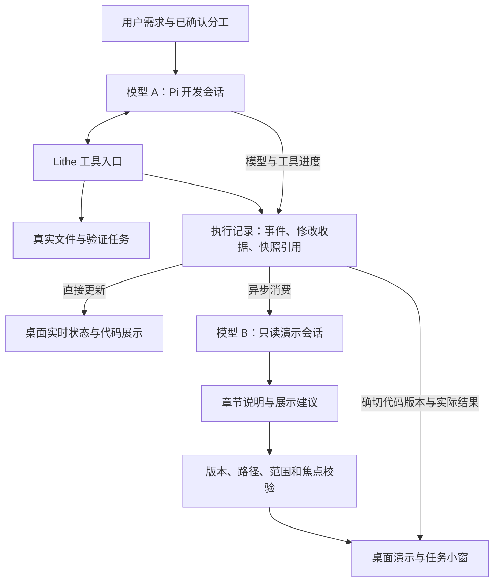

# Pi 双模型异步开发与演示方案

日期：2026-10-15。状态：产品与实施方案，尚未编码或实测。

本方案补充 [Pi 可行性与实施计划](pi-collaboration-feasibility-plan.md)，按用户此前“沉浸式看 AI 写代码”的目标，把开发执行和过程演示分别交给两个模型。两条链路一起设计、接入和验收。

## 1. 产品目标

**开发模型持续完成工作；演示模型异步把真实工作过程组织成能看懂、能暂停、能回看的桌面演示。** 用户看得慢、演示模型响应慢或者临时不可用，都不能成为开发模型等待的原因。

演示覆盖需求分析、分工、查文件、创建修改、验证失败与修复、人工交接和最终结果。首版提供桌面代码展示、文字讲解、章节回放和并行小窗；语音与视频导出不作为双模型闭环的前提。

两个模型有独立配置和会话。开发侧选择代码与工具能力强的模型，演示侧选择响应快、讲解清楚、结构化输出可靠的模型。可以属于不同供应商，也可以使用同一供应商的不同模型。

### 1.1 用户自行配置供应商与角色

用户已明确要求供应商可灵活选择、由自己配置，作为首版必需能力：

- 供应商配置支持自定义名称、API 地址、支持的协议、鉴权方式和密钥；可保存多份配置，包括同一供应商的不同网关或账号。
- “开发模型”和“演示模型”分别选择供应商配置与模型 ID。两者可以跨供应商，也可以复用同一份配置，不绑定指定厂商或推荐模型。
- 各自提供拉取模型、手动填写模型、能力测试和错误详情。开发测试验证工具执行循环，演示测试验证解说与结构化展示建议，结果按角色分别保存。
- 角色绑定引用稳定的供应商配置 ID；密钥仍放系统凭据存储，不复制到角色配置、工作流或演示记录。
- 更改角色绑定只影响该角色后续任务/演示批次。已开始的操作固定配置版本；密钥、地址或模型变化后旧测试结果失效。
- 用户可以在桌面修改配置，无需重新打包；演示模型不可用时继续基础展示。跨供应商自动切换仅在用户另行配置备用规则后启用。

## 2. 三个职责

| 角色 | 输入与输出 | 能力边界 |
| --- | --- | --- |
| 开发模型 A | 接收需求/计划，通过 Pi 读代码、修改、验证、自修复，产生真实执行记录 | 只在确认的开发范围内操作；遵守原方案的核心代码保护 |
| 演示模型 B | 接收已观察到的事件、对应代码快照和计划，生成解说及展示建议 | 只读，不写项目、不跑构建、不批准计划、不控制开发取消 |
| 桌面展示器 | 根据实际事件更新状态、渲染代码与 Diff、执行校验过的展示建议 | 不依赖 B 才显示进度；掌握焦点、历史版本和用户操作优先级 |

B 不重新生成一份项目代码。用户看到的代码来自 A 的真实输出、成功修改收据和保存的快照；讲解来自 B。失败、已写入、已验证等状态由宿主证据确定。

## 3. 异步连接方式



正常执行不含 `等待 B 解说 → A 才执行下一步` 的调用。Pi 事件监听只做轻量事件转交，不能在回调中请求 B、排版长文或等待窗口播放完毕。

开发侧复用 Pi SDK 的独立 AgentSession；演示侧使用另一个无写工具的 SDK 会话。显式提供资源加载器，只给 B 本轮需要的脱敏事件与版本片段，不加载项目可执行扩展。为了隔离崩溃、取消和 CPU 压力，开发与演示优先采用独立 worker 进程，由平台 adapter 管理。

本地修改收据与恢复日志仍是开发正确性的一部分，因此会有必要的记录开销。所谓异步保证的是“不等待演示模型、讲解和播放”，并非承诺所有记录与资源消耗为零。

UI 框架与风格按主计划第 7.5 节：macOS 使用 SwiftUI/AppKit，Windows 延续 Tauri/React，主编辑区复用 Monaco，整体保持已选 A 风格。两个模型的选择入口在工具栏，详细供应商配置在设置页。中央编辑区承载实际代码或标明版本的只读回放，右栏承载章节讲解和提问，底部承载并行任务；开发状态和播放进度分别展示。

## 4. 一次实际使用过程

以用户负责价格计算、AI 负责配套类为例：

| 时刻 | 开发模型 A | 演示模型 B 与桌面 |
| --- | --- | --- |
| 需求进入 | 查找订单接口和项目约定 | 显示“正在定位代码”；已有证据足够后说明相关入口 |
| 分工确认 | 开始创建请求类 | 自动打开目标，直接显示真实草稿/保存结果；B 解释字段来自哪里 |
| 配套继续 | 已开始 Mapper 和测试 | 用户仍可观看请求类这一章，后台照常执行 |
| 验证失败 | 根据实际错误修复配套代码 | 把“失败 → 修复 → 再验证”组织成连续章节，不提前标记通过 |
| 人工编写 | 等待用户完成核心函数，或继续无依赖任务 | 展示交接位置与配套结果；用户直接写代码，演示不抢焦点 |
| 任务结束 | 完成实际工作并交出结果 | 可继续看完剩余章节，或直接跳到最终 Diff 和验证结果 |

界面分别显示，例如“开发：6/8 个任务完成”和“演示：已看 3/5 个章节”。任务数和章节数独立，真实状态不能由观看进度驱动。

## 5. 两种观看模式

### 实时跟随（默认）

自动展示最新的实际读写与验证活动。代码变化直接来自开发事件，不必等待 B。解说按语义批次随后出现；落后的讲解折叠成已有章节，不让旧回复把当前界面跳回过去。

开发比观看快时显示“有新的修改”，用户可以继续看当前内容或跟上最新。任务完成、验证失败和等待人工处理始终在独立状态区及时显示。

### 完整回放

从记录重现本轮已发生的关键步骤，支持暂停、上一章、下一章、倍速和跳到最新。回放用只读历史快照，并清楚标记“执行回放”和记录时间。

已录下的流片段可以按实际先后展示；只有最终快照时，展示真实 Diff 和章节，不补造不存在的逐字生成过程。用户观看回放不修改真实文件，也不重复运行工具。

“完整”的验收范围是每个任务的关键修改、失败、修复、验证和交接都有可追溯章节；重复搜索、连续令牌片段等可以折叠。详细事件仍可展开检查。B 漏掉一个关键事件时，宿主自动生成基础章节补齐，不依靠模型自行承诺讲全。

## 6. 记录、快照与恢复

### 必须记录的事实

- 需求、计划版本、任务归属和实际开始/结束状态。
- 相关读取/搜索的路径与证据引用；不把全部源码无差别复制到日志。
- 创建、修改、删除的真实操作结果，以及修改前后快照或可重建的差异。
- 验证的执行 ID、退出码、报告引用和源码版本。
- 失败、重试、取消、人工交接、人工保存与冲突。

人工未保存输入不默认逐键上传给 B；交接时按用户选择的缓冲区版本或已保存版本形成明确快照。

模型令牌流、重复进度属于可合并的临时事件。成功写入、失败和任务结束等属于需要可靠保存的关键事件。关键修改沿用宿主写入日志记录事件引用；展示索引异步从收据重建，避免增加两套不一致的成功记录。

### 版本关系

每条事实记录至少标识 workspaceID、planVersion、runID、taskID、eventID、事件来源、sourceSequence 和时间。工作区记录器分配展示序列；并发任务的语义先后仍依据依赖与工具调用关系，不靠墙上时钟推断。

代码快照记录 revision/hash 和 before/after 引用。B 对某次修改的解说始终引用这一版快照，不能打开同路径的最新文件代替。缺失的历史内容标记不可用，不悄悄使用当前内容。

采用至少一次投递，消费者用 eventID 去重；不能承诺网络与崩溃情况下天然“恰好一次”。每个演示批次有输入事件集合与版本，旧批次的重试结果不能覆盖新批次。

分别保存记录位置、讲解准备位置和实际播放位置。播放进度由展示器确认，不由 B 的生成完成代替。实时跟随允许跳过若干章节，未看章节仍可回放，不把它们标成已经观看。

### 有界存储

事件与快照放在平台 Application Support 的工作区目录，可复用现有收据引用，使用周期检查点与差异减少体积。活动回放引用的版本不能被清理。存储上限、保留时长和清理策略可配置，历史淘汰后明确标记回放范围。

展示索引损坏时从关键收据恢复或标记局部缺失，开发不等待 B 恢复。若磁盘问题连原有恢复日志也无法持久化，沿用开发保存失败规则暂停写入；不能为了“不阻塞演示”绕开开发自身的正确性要求。

新增资源同步 worktree 复用清单、校验脚本和文档。会话、回放、快照及进度都是工作区私有状态，不跨 worktree 共享，不写 app bundle 或安装目录。

## 7. B 输出的是受约束的展示建议

B 只处理小批量事件、必要代码片段和计划摘要。按文件修改完成、测试结束、交接等节点触发；时间窗用于合并重复进度，不按每个 token 发一次请求。

建议输出结构如下，字段仅为待实现契约草案：

```json
{
  "schemaVersion": 1,
  "runID": "example-run",
  "presentationEpoch": 2,
  "chapterID": "mapper-update",
  "sourceEventIDs": ["event-41", "event-42"],
  "snapshotID": "snapshot-12",
  "title": "补齐订单字段映射",
  "explanation": "本次修改增加了已确认字段的转换。",
  "actions": [
    { "type": "show_diff", "path": "src/OrderMapper.java" },
    { "type": "highlight_lines", "startLine": 18, "endLine": 26 }
  ]
}
```

宿主校验来源事件、快照、行号和允许动作，仅开放展示文件、展示差异、高亮、章节、文字说明及任务窗口建议。目录和文件树可显示该历史时点的只读投影；创建真实文件只发生在开发链路。

B 不输出可执行脚本、任意 HTML、文件内容替换、命令或开发权限。测试是否通过、任务是否完成等状态直接由结构化证据生成；自由文字是带来源的 AI 解说，不能取代实际状态。解说可以解释修改目的，但不声称知道模型未公开的内部推理。

## 8. 暂停、提问和接管

| 用户动作 | 开发链路 | 演示链路 |
| --- | --- | --- |
| 暂停演示 | 继续工作 | 停止播放和自动导航；记录继续，预生成受预算限制 |
| 关闭一个小窗 | 继续对应任务 | 只销毁视图，不丢章节 |
| 跳到最新 | 无需重启 | 取消过时导航，切到当前状态，保留回放记录 |
| 问“为什么这样改” | 继续工作 | B 依据当前观看的快照回答，必要时附“当前代码已有更新” |
| 要求修改代码 | 宿主把明确意图与相关版本送入开发控制流程 | B 不直接把普通讲解或猜测转成开发指令 |
| 点击“我来写” | 撤销相关写许可、清队列、取消并等提交边界稳定 | 停止相关自动导航；历史视图跳到当前真实文档后再编辑 |
| 停止开发 | 取消对应开发任务，保留已提交收据 | 可以继续回放已经发生的部分 |
| 项目关闭/IDE 退出 | 取消并清理所有所属开发进程 | 同时停止演示请求、关闭小窗并保存观看位置 |

人工输入、固定文件和手动滚动拥有焦点优先权。B 只能建议导航，不能覆盖用户选择。演示批次使用独立的 presentationEpoch；跳转、换项目和切观看模式后，旧请求即使返回也不能改变当前视图。

等待业务决策或范围确认的开发任务仍应正常等待用户。确认入口显示当前计划的真实版本，并且立即可用，不必先看完整段演示；B 无权代替用户确认。

## 9. 不拖慢开发的具体措施

1. 两条链路独立请求队列、取消令牌和进程生命周期，开发取消不受 B 返回速度影响。
2. 开发与用户主动提问优先；演示背景解说一次只允许一个批次在途，并合并未开始的批次。
3. 供应商允许时分别设置 API Key/限额。共用账号可能共享限流，单纯选择不同模型不能保证吞吐独立；同账号时为开发预留请求与令牌预算。
4. B 使用增量 Diff、摘要和按需片段，避免重复发送整仓库和开发对话；两侧费用分别统计。
5. 关键事件持久化后按游标消费，内存队列有上限。临时进度可合并，关键事件不能静默丢弃；回放按需生成解说，避免积压无限增长。
6. B 超时、限流或无效输出时，用宿主基础章节和真实 Diff 继续展示，后台做有上限重试。
7. 不把 B 的自由文本自动反馈给 A 触发无限自我修复。用户明确要求修正时，A 根据当前源码版本重新核实。

这保证演示延迟不成为开发的逻辑依赖。模型配额、CPU、内存、磁盘和网络仍可能竞争资源，必须通过实测与预算控制验证影响，不能宣称“完全零开销”。

## 10. 完整交付顺序

双模型从第一版协议就纳入，不等开发全部完成后再外挂演示功能。

| 顺序 | 开发与记录侧 | 演示与桌面侧 | 必须一起验证 |
| --- | --- | --- | --- |
| 1：定义真实事件与最小闭环 | 单任务创建/修改文件、收据与版本 | 基础跟随、真实 Diff、B 简短解说 | B 延迟或退出时 A 能继续 |
| 2：补全异步消费 | 持久事件、快照、去重、重连 | 独立观看进度、暂停/回放/追上最新 | 已被多次修改的文件仍可准确回放 |
| 3：串起全流程 | 分工、验证、修复、交接 | 对应章节、证据链接、随时提问 | 所有关键步骤都有章节；接管不覆盖人工代码 |
| 4：加入多开发任务 | 两个独立任务、依赖与文件竞争 | 聚合章节、主区固定、并行小窗 | 讲解对应正确任务/版本，窗口不抢焦点 |
| 5：独立更新与整体验收 | 版本兼容、资源生命周期与恢复 | 演示模板/策略单独更新、错误降级 | 更新和回滚不丢真实记录或观看进度 |

这是一套完整功能范围，按可验证的顺序落地。后台执行与展示开发可基于固定事件样例分别迭代，最终必须用真实 Pi 事件联调，模拟演示不计作真实执行验收。

相较原计划增加“持久回放与双模型联调”约 3–5 工作日的初步预算，合入主计划 P1b。P0 同时验证两模型配置、共享限流影响与事件体量，再调整工期。

## 11. 验收重点

| 场景 | 通过条件 |
| --- | --- |
| B 响应延迟、断网或被终止 | A 可继续执行和结束；桌面仍能显示实际状态与基础章节 |
| 开发与演示使用不同供应商 | 分别使用所选地址、协议、凭据和模型；请求与用量正确归属各自角色 |
| 修改其中一个角色的配置 | 另一角色保持当前绑定，已开始操作使用原配置，后续操作使用新配置 |
| 用户暂停演示 | 文件仍由 A 正常推进；演示恢复后从已观看位置继续 |
| 同一文件被连续修改三次 | 三段讲解各自绑定正确版本，历史回放不改变当前文件 |
| B 输出过时路径、错误行号或无来源结论 | 展示建议被拒绝或降级，真实状态保持正确 |
| 事件重复、缺序或断线重连 | 不重复播放已确认动作；缺口恢复或明确显示，不伪造连续性 |
| 大量事件积压 | 内存有界，关键收据可恢复，开发不等待讲解消费完 |
| 失败后修复成功 | 回放保留失败过程，最新状态依据最后一次有效验证证据 |
| 用户从历史章节接管 | 打开当前文档并执行取消与版本核对，不把旧快照覆盖到源码 |
| 两个开发任务同时修改不同文件 | 展示来源正确，依赖变化时暂停受影响任务，固定视图不跳走 |
| 共享账号限流 | 背景演示降低频率，开发预算优先；费用和降级原因可见 |
| 重启应用 | 开发任务先暂停恢复，演示进度可恢复，不自动重复执行工具 |
| 关闭项目 | 两侧所有所属进程/窗口完成清理，用户其他进程不受影响 |

记录关闭 B 与开启 B 的工具间隔、开发总耗时、展示延迟、队列峰值和两侧消耗，先用可控假模型验证确定性，再用真实服务商确认体验。模拟网络等待有上限，性能统计作为测量证据，不用不稳定的墙钟阈值冒充可靠回归测试。

## 12. Pi 已有能力与本次新增能力

Pi 已提供独立会话、模型配置、消息与工具事件、取消和会话存储；依据沿用主计划中的官方 SDK 与事件文档来源。

执行事实记录、版本快照引用、演示章节、播放游标、焦点仲裁、积压降级和双角色配置属于待实现的 Lithe 能力。正式实现时同步新契约、Agent Note、平台矩阵和相关测试，不能把本方案文档当成已完成的功能。
