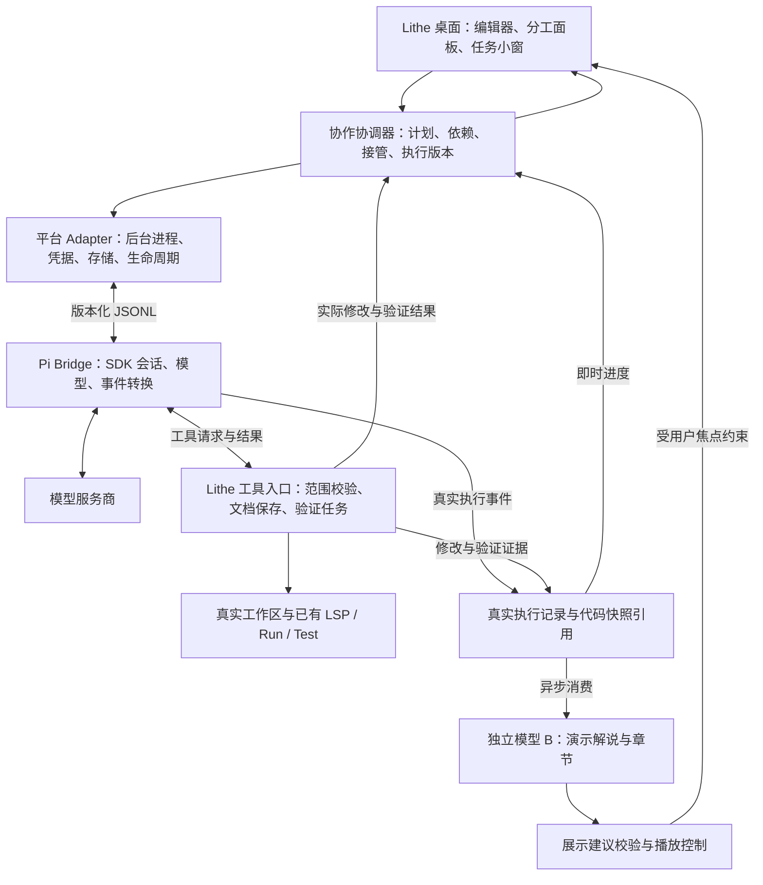

# 基于 Pi 的 Lithe 人机协同：可行性评估与实施计划

日期：2026-10-15。状态：调研完成，待按里程碑验证与实施。

本轮补充：用户要求开发与演示分别使用一个模型并异步运行。具体执行规则见 [双模型异步开发与演示方案](pi-async-development-presentation-plan.md)，以下架构和交付阶段已同步该方向。

本文是本次选型报告和工作计划，不代表新架构已经实现。正式接入时，架构取舍进入 Agent Note，协议进入 shared/contracts，本文件保留目标、交付顺序和验收依据。

## 1. 结论

**可以基于 Pi 实现这套产品，而且它比继续扩展当前“模型生成 JSON 修改”的链路更适合作为执行引擎。**

建议保留 Lithe 桌面、编辑器、项目工具和 A 风格，把协作执行改为 **Pi SDK + 独立后台进程 + Lithe 控制文件操作与任务分工**。Pi 负责持续调用模型、使用工具、维护上下文和会话；Lithe 负责决定 AI 可以改哪里、你什么时候接管，以及把执行过程真实地显示在编辑器里。

开发模型和演示模型分别配置、分别运行。开发侧产生真实事件与修改收据，演示侧异步消费对应版本的记录，生成解说和章节。基础代码展示由桌面直接驱动，开发不等待演示模型或用户看完；演示支持实时跟随与明确标识的历史回放。

Pi 不直接提供成品的人机协作 IDE。计划分工、核心代码保护、自动跟随、并行小窗、补全体验和扩展更新仍需要开发。接入它能省掉模型和 Agent 执行层的大量重复建设，不能单凭换引擎保证界面体验。

第一交付目标是一个可实际操作的闭环：**输入需求 → AI 找源码 → 确认分工 → AI 自动创建配套文件并显示真实修改 → 用户接管核心逻辑 → AI 检查实现和真实测试结果**。

## 2. 调研对象与证据范围

用户提到的 Pi 按 Mario Zechner 的开源 coding agent 理解。GitHub 已确认原地址 `badlogic/pi-mono` 跳转到 [earendil-works/pi](https://github.com/earendil-works/pi)。

| 项目 | 已核实内容 |
| --- | --- |
| 官方仓库 | `earendil-works/pi`，原 `badlogic/pi-mono` |
| 许可证 | MIT；分发时保留版权与许可文本，另核对随包依赖的许可证 |
| 调研时最新正式版 | [v1.2.0](https://github.com/earendil-works/pi/releases/tag/v1.2.0)，发布于 2026-10-12 |
| 正式版提交 | `06a466935536f8c9bcacb2d5efc0fc021be1bdff` |
| 同时查阅的主分支提交 | `4a5d37291531ad48b8e536c892557877d219463c` |
| 当前 SDK 包名 | `@earendil-works/pi-coding-agent`；旧文章的包名和 API 必须按固定版本重新核对 |
| Node 要求 | v1.2.0 的 package.json 要求 `>=22.19.0` |
| Lithe 评估基线 | 已交付沉浸式分支提交 `45d92c0c317256cd125865c31150f25502ece53a` |

已阅读官方 SDK、RPC、事件、扩展、模型、权限文档及相关源码，也查看了社区 pi-acp 的能力限制。关键 SDK/RPC 文档在上述主分支与正式版之间无差异；实施依赖仍应固定正式版和完整锁文件。

**本次没有安装并运行 Pi，没有调用你的模型账号，也没有做桌面联调或性能测量。** 下文的产品方案和工期是基于源码评估的建议；运行可行性由 P0 验证，不能把文档描述当成已经通过测试。

## 3. 现有实现为什么还不够

当前 `CollaborationFeatureModel` 从有限文件采样生成计划，`CollaborationDraftService` 请求模型输出 changes 数组，验证后一次提交。模型指令明确声明没有文件和进程工具。它能够展示真实文本流，但难以自己继续查文件、追调用、执行验证并按失败修正。

目前的并发也是“一个步骤内，多个文件分别生成草稿”，并非多个持续工作的 Agent。任务小窗显示的是生成过程，不能自然呈现完整的“探索—修改—运行—修复”过程。

因此本轮工作的重点应是替换协作执行机制，并接通真实工具事件；继续调整面板样式无法独自解决这个差距。

## 4. 你的需求与 Pi 的对应关系

| 需求 | Pi 可以复用的部分 | Lithe 仍需实现的部分 |
| --- | --- | --- |
| 先理解开发/维护需求和现有代码 | 持续的 Agent 循环、读取和搜索工具、会话上下文 | 项目入口、IDE 诊断、需求证据、分工计划及确认 |
| DTO、Mapper、配置等配套交给 AI | 多轮工具调用、文件修改、工具结果后继续推理 | 已授权范围、文件/方法保护、可撤销保存 |
| 核心逻辑自己写 | 工具选择、取消、消息队列 | 人工所有权、编辑锁、接管动作、脏缓冲区保护 |
| 沉浸式看 AI 创建/修改文件 | `toolcall_*` 和 `tool_execution_*` 事件 | 自动导航、草稿叠层、真实文件同步、编辑位置高亮 |
| 开发与演示使用不同模型 | 独立会话与模型配置、可订阅的真实执行事件 | 异步记录、代码版本快照、演示章节、独立播放进度与失败降级 |
| 并行任务与小窗 | 独立会话；官方有 subagent 扩展示例 | 依赖图、文件竞争控制、任务卡、小窗和总预算 |
| 写完后 AI 分析 | 只读工具与独立审查会话 | 当前代码版本、诊断跳转、验证报告与修复建议 |
| 写核心代码时补全 | 模型访问与上下文能力可复用 | 光标补全、建议显示、接受/拒绝、低延迟与取消；Pi 不直接提供 IDE 补全成品 |
| 供应商、模型列表与测试 | 多供应商 API、模型运行时、自定义端点 | 现有配置迁移、远端列表发现、连通/流式/工具测试 |
| 少打包、多扩展 | Skills、提示模板、TypeScript 扩展、资源重载 | 有版本的独立功能包、兼容协商、校验、回滚及原生贡献点 |

官方 README 明确没有内置完整的 plan mode 和 sub-agent 产品流程；仓库有对应扩展示例。示例可以参考，不把示例的权限或调度策略直接当成 Lithe 的生产实现。[S1][S7][S8]

## 5. 接入方式选择

| 路线 | 优点 | 对本项目的限制 | 建议 |
| --- | --- | --- | --- |
| 在终端中运行 Pi | 最快验证模型与工具能力 | 不能自然承担原生编辑器跟随、人工保护和任务小窗 | 仅作引擎对照 |
| Pi 官方 RPC + 配套扩展 | JSONL 跨语言接入成熟，已有执行事件 | 工具回调、宿主保存和资源加载策略需要扩展桥；部分 TUI UI API 在 RPC 下不可用 | 可作 P0 对照与备选 |
| **Pi SDK 封装独立后台进程** | 显式控制工具、资源、模型、会话和订阅；适合宿主接管写入 | 要维护一个薄的进程协议与平台生命周期 adapter | **主方案** |
| 社区 pi-acp + 现有 Lithe ACP Host | 可复用当前 Agent 对话与事件展示 | 项目自述 MVP；不提供 ACP 文件系统/终端委托，Pi 仍本地直接读写；配置单独管理 | 后续普通 Agent 入口候选 |
| 深度 fork Pi 或只拿底层模型库重写 Agent | 定制自由 | 容易重新维护 Agent 循环、上下文和供应商差异 | 当前不采用 |

SDK 进程仍完整复用 `createAgentSession`、`SessionManager` 和模型运行时。我们只增加 IDE 适配与产品调度，不重写 Pi 的循环、压缩、会话树和重试实现。

现有 ACP Host 是 ACP 连接的所有者，不应强行承载另一套不兼容消息。Pi bridge 使用独立端口和版本协议；共用可复用的进程清理、日志与配置能力。Pi 官方 RPC 的事件语义可作为映射依据，但我们的 bridge 协议不能冒称官方 RPC。[S2][S3][S10]

## 6. 目标架构与所有权

| 所有者 | 负责什么 |
| --- | --- |
| Pi | 对话历史、模型调用、上下文压缩、工具循环、已有重试语义 |
| Lithe 协作协调器 | 任务依赖、人工/AI 归属、授权版本、暂停接管、任务结果 |
| 演示模型与展示服务 | 根据真实版本生成解说，维护章节和观看进度；没有项目写权限，不控制开发验收 |
| Rust Core | 可跨平台复用的确定性范围校验、计划转换和事件数据校验；不启动 Node、不重建语言语义 |
| macOS / Windows adapter | 进程与子进程、系统凭据、文件字节与编码、原生文档、窗口、可写存储 |
| 现有语言及执行工具 | 符号、项目依赖、诊断、编译、测试和运行配置 |

开发与演示的会话正文分别由 Pi 管理；Lithe 保存角色与 session ID 映射、任务图、授权、修改收据、验证引用和演示进度。演示事实索引从宿主收据建立，不另维护一套开发对话真源。

建议新增位置为 `integrations/pi-bridge/`（需在正式架构 Note 中登记所有权）、`shared/contracts/collaboration-agent-v1.md` 与跨平台 fixtures。Swift 侧沿用 `Core/Ports`、`Services`、`Application/Features`、`Platform/MacOS`、`Views/Collaboration` 的现有分层；Windows 单独实现 Tauri adapter 和 React 展示。

## 7. 用户实际怎么使用

### 7.1 从需求进入分工

用户描述“新增一个业务功能”或“修改已有规则”。AI 自动读取允许的项目文件、查找相关实现，并引用实际路径说明判断。代码位置、项目结构等可从工具获知的内容，不再逐条反问用户。

生成的计划至少包含：任务目标、负责人、文件/符号范围、前置依赖、配套项、验收方式、未决业务问题。关键业务歧义集中到一轮问题；可采用的技术默认值直接写进计划。

例如用户自己实现 `OrderService.calculatePrice`，AI 负责已约定字段的请求/响应类、Mapper 和配套测试。接口签名先定；依赖未定的任务显示“等待接口”，不能靠猜测并行。

用户可以直接修改分工，再确认一次。确认后的范围内自动执行；扩大写入范围、改变业务规则时才再次提交具体变更供用户决定。

### 7.2 自动工作与观看

开始 AI 任务后，桌面自动打开它正在创建或修改的目标。左侧项目树出现实际新文件，中间展示代码，右侧显示简短工作说明，底部显示运行中的任务。

收到模型的工具参数流时，可以在编辑器旁显示“生成中”的只读预览；一次完整文件操作成功后，由文档系统显示真实保存内容。模型尚未给出路径、服务商尚未发出代码，或工具还没有成功时，准确显示等待/生成/执行，不能提前宣称已写入。

这里的“实时”由模型与工具实际事件驱动，不保证模型逐字符修改磁盘，也不用播放动画代替真实事件。Pi 通常在参数完整后执行工具；这一点必须在 P0 的视觉样机里让用户实际判断是否达到期望。

演示解说不在开发执行的等待链上。开发已完成后仍可继续观看章节；回放使用当时的只读快照，不能用最新文件讲旧修改。暂停演示不暂停开发，实际状态和观看进度分别显示。演示模型失效时保留真实 Diff 和宿主生成的基础章节。

### 7.3 人工编写与审查

点击“我来写”或开始编辑受影响文件后，停止自动跟随并撤销该文件的 AI 写入许可。待正在提交的原子写入结束并核对文档版本后，交出编辑控制；已经写入的有效内容保留，接管不自动回滚。

AI 可继续处理没有依赖、没有冲突的其他配套文件。你写完核心逻辑并交接后，审查任务读取当前版本和诊断；建议默认只读。真正运行过的编译/测试，单独展示命令配置、退出码、报告和所针对的源码版本。

核心逻辑补全使用独立的建议通道：先支持选中代码/光标处主动请求，按 Tab 或按钮接受，Esc 拒绝。后续再加入去抖的自动补全。每次光标、文件版本或输入变化使旧建议失效；建议未经接受不落盘、不启动后台修改任务。

### 7.4 并行任务与小窗

先开放两个独立任务，稳定后上限可设为三个。每个任务拥有独立 Pi 会话和明确的读写范围。相同文件、共享生成器、依赖接口尚未稳定的任务串行。

主区默认跟随第一个正在修改代码的任务；其他任务显示底部卡片，可展开成非模态小窗。用户固定任务后，自动切换停止。可提供“轮播运行中任务”，避免每条流事件都随机抢走正在看的文件。

小窗关闭只关闭视图；停止任务是独立动作。切换项目、退出 IDE 则停止对应后台任务并清理子进程。暗色、浅色、缩放、滚动、拖动和键盘焦点都沿用现有共享控件。

### 7.5 UI 框架与 A 风格

界面延续用户已选择的 A 原型，参考现有 `collaboration-v2/index.template.html` 的层级与交互。HTML 负责设计验证；产品交付为 Lithe 桌面。

| 部分 | 建议技术与组件 |
| --- | --- |
| macOS 工作台、工具栏与协作面板 | SwiftUI + AppKit，复用现有 Lithe 原生控件与主题 |
| 主编辑区 | 现有 Monaco 和文档生命周期；人工编辑继续使用原有保存、撤销与语言服务 |
| 任务小窗 | AppKit NSPanel 与现有只读代码组件；按需创建，关闭释放视图 |
| Windows 桌面 | 现有 Tauri 2 + React 19、共享编辑器与 Windows 组件体系 |
| Pi 与两个模型 | 后台执行与讲解，不拥有原生布局、样式或任意 UI 执行权限 |

视觉保持 A 的石墨灰暗色、低对比面板层级、细边界与少量蓝色强调，同时支持浅色。人工归属用暖色标签，成功、失败、等待使用既有语义颜色并配文字/图标；具体色值映射到平台主题，不在协作视图硬编码另一套主题。macOS 普通文字和代码分别使用已有 Inter 与 JetBrains Mono 字体入口，字号服从 IDE 设置，不照搬 HTML 原型里的小字号。

布局以代码为中心：左侧项目树，中央代码或 Diff，右侧当前章节与提问，底部并行任务条。右栏可收起，小窗按需展开。常驻工具栏用两个紧凑选择器显示“开发：供应商 / 模型”和“演示：供应商 / 模型”；API 地址、密钥、拉模型和诊断放入设置页。

中央顶部区分“实时”和“回放”，展示当前文件版本；演示播放操作与开发停止操作使用明确文字。底部独立显示开发状态与观看进度，避免一个暂停按钮控制两个含义。模型 B 输出的展示动作只映射到已实现的原生组件。

菜单、搜索、滚动条、分隔条、焦点、主题和字体沿用共享所有者。演示高频文本只更新当前文字视图，代码增量只刷新对应文档，避免每个 token 重新布局整张工作台。可配置颜色与布局参数也必须受宿主支持范围和可读性约束。

视觉验收覆盖真实桌面的实时执行、延迟讲解、历史回放、人工输入、双模型设置和两个并行任务；检查浅/暗色、窄窗口、缩放与键盘操作。HTML 通过不能替代这些原生场景。

## 8. 核心逻辑保护必须怎样实现

### 8.1 计划是宿主权限，不是模型提示词

计划记录 `owner`、允许的相对路径、必要的方法范围、文档基线、计划版本和执行 ID。Pi 获得的是可请求的工具集合，不能通过输出一句“我需要更多权限”自行扩展范围。

第一版默认按文件归属划分。已有 Java 方法级边界可以复用当前 Core 检查，但不支持的方法或语言不伪装成可靠方法保护。混合所有权的 Java 文件需要针对实际语法结构验证；导包、修改声明与方法体修改是不同授权。

### 8.2 每次修改经过现有文档链路

工具入口按顺序执行：

1. 核对当前 workspace、planVersion、runID 和文件/方法授权。
2. 校验规范路径、实际文件身份、符号链接和目标归属。
3. 检查原始字节/文档 revision，拒绝覆盖目标的人工未保存内容。
4. 计算和验证修改，写入恢复日志，再通过原生保存 adapter 提交。
5. 记录真实收据，通知编辑器与语言服务，最后返回工具成功。

优先复用 Pi 工具工厂提供的 operations 接口与成熟的修改逻辑；最终授权、编码和原子保存由 Lithe 完成。不能让默认 `write`/`edit` 直接绕过文档所有者。

旧执行器是整组草稿一次提交，新 Agent 会多次成功修改后再遇到失败。必须增加按工具调用的连续收据和任务检查点：失败保留此前有效修改并标记“任务未完成”；撤销按收据逆序处理，遇到人工改动停止并显示冲突。不能宣称跨文件天然原子，也不自动清空用户工作区。

### 8.3 工具受控不等于操作系统隔离

Pi 官方明确默认使用启动用户的权限；扩展是同进程代码，`cwd`、Git worktree、提示词、工具确认都不构成完整隔离。[S5]

首版使用显式 ResourceLoader 和工具清单，只加载随产品验证的扩展。禁止自动加载项目中的可执行扩展、任意 MCP、`bash`、`powershell`、`codemode` 和执行式凭据配置。项目说明作为有来源的上下文读取，不能改变工具权限。

原始项目的实际写入只通过 Lithe 工具入口。P0 必须验证后台进程对原始源码的写访问边界；如果要运行模型生成的命令或项目构建脚本，还必须验证涵盖子进程的操作系统隔离。构建脚本即使名为 test 也可能修改任意路径，仅靠命令前缀不够。

优先通过现有 Run/Test 提交结构化验证任务，并在隔离的验证副本中执行，记录其源码身份。macOS sandbox/helper 与成熟隔离工具的取舍在 P0 用实际签名、启动和子进程行为确定；Windows 另测访问控制边界，Job Object 只负责生命周期，不等于文件访问隔离。

若 P0 无法证明上述边界，先交付只读分析和受控文件操作的实验版本，自动执行任意命令保持关闭，不把“完整核心保护 + 自动验证”标记为完成。

## 9. 执行、取消与并发协议

后台进程使用带版本的 UTF-8 JSONL，标准输出只放协议，诊断写标准错误。持续读取管道、处理背压，限制单消息和积压大小。事件展示可合并，文件提交、失败、结束等关键事件不能丢失。

宿主封装至少带 `protocolVersion`、`workspaceID`、`planID`、`taskID`、`sessionID`、`runID`、`sequence`；工具请求额外带 `toolCallID` 和文档基线。路径持久化为工作区相对路径，绝对路径仅留平台内部。

| Pi 事实或事件 | Lithe 的行为 |
| --- | --- |
| 模型请求已开始但没有输出 | 显示等待，保留停止操作 |
| `message_update / toolcall_delta` | 展示真实草稿参数，不能当作已提交修改 |
| `tool_execution_start` | 显示当前动作，可按规则打开目标 |
| Lithe 保存成功收据 | 更新真实文件、变更列表与可撤销记录 |
| `tool_execution_end` | 记录工具成功/失败及耗时，结合保存/测试证据判断结果 |
| `agent_end` | 一次底层循环结束，仍可能重试或处理队列 |
| `agent_settled` | Pi 不再自动继续；宿主再检查工具结果、验证与验收状态 |

“我来写”不能用 `steer("停止")` 代替取消。官方说明 steer 会排队；`abort` 也不替代队列清理。接管流程是先撤销写入代次并停止调度，再 `clearQueue()`、`abort()`，取消宿主拥有的工具任务，等待正在进行的保存/进程结束。超出有界退出时间，终止该任务拥有的进程树并核对恢复日志。迟到事件、工具结果和保存请求都按 runID 拒绝。[S2][S4]

并发任务不仅要检查写集合，还要记录读取依赖。A 修改了 B 依赖的接口时，即使两者写不同文件，也要暂停 B 并刷新基线。并发预算包含总模型请求数、重试次数、工具轮数和报告输出；提供计划级成本/令牌预算，未知费用显示未知。

现有 Core v1 是串行步骤状态机。并行任务图需要明确的 v2 契约与迁移，不直接把 v1 的“当前步骤”悄悄改成多个。第一闭环保持串行，完成接管与恢复后再开放任务图。

## 10. 模型配置与可用性

复用 Lithe 已有供应商记录、Keychain/平台凭据与模型拉取能力。Pi 统一承担协作 Agent 的模型请求；不要求用户再手动维护另一份 auth.json。

设置中分别提供“开发模型”和“演示模型”的供应商、模型、预算及测试入口。开发侧验证完整工具循环，演示侧验证流式解说与受约束结构化输出；演示未配置或暂不可用时，基础执行展示仍可使用。两侧记录独立用量，同账号共享限流时为开发预留预算，不能把不同模型误当成独立配额。

用户已确认供应商由自己灵活配置：允许保存多份自定义 API 地址、协议和账号配置，开发/演示分别绑定供应商配置与模型。支持跨供应商组合、模型自动拉取和手填，以及独立能力测试。配置修改无需重新打包，活动操作固定原配置版本；具体规则见双模型方案第 1.1 节。

| 检查 | 通过说明什么 |
| --- | --- |
| 拉取模型 | 端点返回模型 ID；不证明有调用权限或支持工具 |
| 基础对话 | 当前凭据、协议和所选模型能完成一次请求 |
| 流式输出 | 能收到并正确结束真实事件流；不能只根据 HTTP 200 判断 |
| 工具调用 | 模型能产生有效参数、接收工具结果并继续完成任务 |

工具测试使用无副作用的临时工具和测试数据，不触碰用户项目。对话可用但工具不可用的模型标记为“可用于问答/审查”，不能显示为完整执行可用。

自定义 OpenAI 兼容地址沿用现有分页、取消和错误处理；远端不支持 `/models` 时允许手填。Pi 自带模型目录与用户网关的实时列表分别显示来源，不能混为一谈。[S6]

凭据通过私有进程通道短暂提供，使用 Pi 的 runtime key 或 CredentialStore 适配，不进入命令行参数、日志、工作流包和会话正文。密钥或模型变化后使旧测试结果失效；活动任务固定模型，新选择默认影响下一任务，避免悄悄切换。

首版支持现有 API Key 路线。OAuth/订阅登录单独评估各供应商支持，不承诺已有订阅必然能转为 SDK 调用。

## 11. 怎样减少后续完整打包

采用两个更新单元：**桌面宿主**与**协作运行包**。首次接入需要更新宿主；以后在宿主已支持的能力内更新策略、模板与 Pi 适配层。

| 改动 | 是否需要重新打完整 IDE 包 |
| --- | --- |
| 提示词、需求分析模板、分工规则、验收模板 | 不需要；校验后切换数据包版本 |
| 演示讲解模板、章节策略和已有展示动作的组合 | 不需要完整 IDE 包；独立更新演示包，活动回放固定版本 |
| 模型配置、供应商兼容元数据 | 通常不需要；新鉴权/传输能力另评估 |
| 已有工具范围内的 Agent 策略与自有 TypeScript 扩展 | 不需要完整 IDE 包；独立运行包需要验证和发布 |
| Pi SDK 补丁升级 | 协议、Node 和宿主能力兼容时更新独立包，并重启空闲后台进程 |
| 已有原生组件的文案、显隐、有限布局和主题参数 | 提前做成受校验配置后不需要；不承诺任意 UI 热更新 |
| 新原生窗口交互、编辑器接口、系统权限、隔离能力 | 需要升级宿主 |
| Node 原生运行时、签名/加载策略、跨版本协议变化 | 必须重新验证；可能需要宿主安装包更新 |

运行包清单建议包含包版本、Pi 精确版本、Node 范围、支持的宿主协议、所需能力、平台/架构、内容哈希及发布签名。安装到平台 Application Support 的版本目录，校验完成后原子切换指针；保留可回退版本。活动任务固定包版本，更新等空闲后生效，不能在一次运行中更换工具实现。

会话、日志、模型目录缓存、临时验证目录均由平台存储 adapter 解析。macOS app bundle 与 Windows 安装目录只读。封装 Node/Pi 依赖使用可复现锁文件，正常运行不自动 npm install 或跟随 latest。

资源新增时必须同步 `scripts/worktree-resources.json`、资源复用脚本校验路由、对应测试和 `docs/ci-builds.md`。仅可证明身份且不可变的资源允许复用；会话、索引、验证副本和可变构建状态不共享。

开发过程中先更新 bridge 和数据包、跑协议及原生针对性验证；原生改动使用匹配工具链增量编译。到可验收里程碑再产出 DMG，完整安装、签名与升级测试仍不可省略。

## 12. 已有代码的保留与迁移

| 现有能力 | 处理方式 |
| --- | --- |
| 原生编辑器、项目树、LSP、Run/Test | 保留，作为工具与展示所有者 |
| `MacCollaborationWorkspace` 保存、编码、路径检查、恢复记录 | 复用并扩展为多次工具写入的连续收据 |
| Core 的 prepare/reverse 与方法范围校验 | 保留；任务图和授权变化建立新契约与 fixtures |
| A 风格布局、任务选择、小窗 | 复用合适控件，改为订阅真实任务和工具事件 |
| `CollaborationDraftService` 的一次性 JSON 生成 | 新执行器验证后退出主路径，迁移期保留旧流程可读与明确回退 |
| 旧 HTTP 协作流解析 | 不再为 Pi 链路维护第二套供应商实现；其他仍使用它的功能另行保留 |
| 供应商配置与模型发现 | 复用，加入 Pi 运行时映射与工具能力测试 |
| 普通 ACP Agent 面板 | 维持独立入口，不把其权限描述为受协作计划保护 |
| v1 导入包与历史任务 | 仍可读取；用户明确开启新任务时迁移，活动任务不静默转换 |

新增原生能力同时维护平台矩阵。macOS 优先达到实机可用；Windows 未实现/未验证分别记录，不因 TypeScript 可运行就标记已支持。

## 13. 里程碑、工期与完成条件

以下按一名熟悉当前仓库的全职开发者估算，不是交付承诺。P0 后依据隔离、工具链和真实供应商结果重新估算。代码编译通过不等于体验验收。

| 阶段 | 预计投入 | 具体产物 | 进入下一阶段的条件 |
| --- | --- | --- | --- |
| P0：引擎与边界验证 | 2–3 工作日 | 固定 Pi 版本的最小 bridge；真实模型的读、改、流、取消记录；隔离与安装方式验证；双模型事件对接 | 能解释每次事件对应的真实行为，取消/越界写入/资源写入检查通过；原生最小视图可观看；演示模型延迟不阻断开发 |
| P1：单任务桌面闭环 | 3–5 工作日 | 自动定位、真实创建修改、保存收据、接管、失败与重启恢复；基础解说 | 一次需求能完成一个配套类；用户中途编辑不被覆盖；窗口不抢焦点 |
| P1b：异步演示与回放 | 3–5 工作日 | 关键事件与快照、双角色模型配置、完整章节、独立观看进度、积压与错误降级 | 暂停演示时开发继续；连续修改同文件能准确回放；演示不可用时真实进度仍可见 |
| P2：人机分工与验证 | 4–6 工作日 | 开发/维护两类计划、核心范围保护、只读审查、受控真实测试、自修复预算 | 用户能写核心逻辑，AI 只做授权配套；测试报告与代码版本匹配 |
| P3：并行与小窗 | 3–5 工作日 | v2 任务图、两个会话起步、文件竞争与读取依赖、小窗/固定/轮播 | 并行有实际收益，同文件与依赖变化不会误覆盖，全部子进程可回收 |
| P4：补全与模型体验 | 3–4 工作日 | 主动补全、接受/拒绝、版本失效；模型发现和四项能力检测 | 核心逻辑始终由用户接受建议后改变；模型失败可定位原因 |
| P5：独立更新与集中交付 | 3–5 工作日 | 运行包校验、空闲切换、回滚、安装与升级验证、完整桌面验收 | 更新一份模板和一份兼容运行包不重打 IDE；回退后项目/会话完整 |

加入双模型异步演示后，macOS 完整首轮暂估 **21–33 工作日**；P0–P2（含 P1b）的核心闭环约 **12–19 工作日**。这些阶段允许用一次开发宿主持续调 bridge，不要求每阶段给用户重装一次。P0 测得双模型限流、事件存储和版本回放成本后再调整估算。

Windows 正式产品适配另估 **7–12 工作日**，其中隔离和原生进程行为必须实机验证。P0 可先做 Windows 协议/依赖启动探测，以便尽早发现平台不兼容。它不计入当前 macOS 完整验收工期。

若 P0 证明逐次真实编辑在观感上仍达不到期望，或者后台隔离/取消无法满足边界，先修正该方案，不继续堆任务面板和完整打包。P1 的实际操作样机是体验判断点。

## 14. 验收清单

| 场景 | 必须看到或检查到的结果 |
| --- | --- |
| 全新开发需求 | 找到真实项目约定；计划列出核心工作与 DTO/Mapper/配置/测试等配套 |
| 维护已有代码 | 先引用受影响文件和调用关系；保留不在范围内的行为 |
| 未打开任何源码 | AI 能通过工具找文件，用户不必手工给每个路径 |
| 创建文件及父目录 | 获准目录中真实创建，项目树与主编辑器同步出现 |
| 实时观看修改 | 能区分生成中、执行中、已写入；最终文本与磁盘/文档一致 |
| 演示模型缓慢、失败或暂停播放 | 开发继续，真实状态即时更新，解说可以延后或退回基础章节 |
| 同文件多版本回放 | 代码与讲解绑定同一历史快照，回放不改真实文件，可跳到最新 |
| 全流程演示 | 分析、修改、失败修复、验证和交接都有证据章节，观看完成不冒充开发验收 |
| 中途“我来写” | 队列清理、写权限失效、停止跟随；迟到结果不改代码 |
| 目标有未保存人工内容 | 不静默保存、不覆盖；显示冲突或等待交接 |
| AI 碰到核心方法 | 写入被宿主拒绝；修改范围只能通过新计划决定 |
| 两个独立任务 | 同时显示真实活动；可固定主区、缩小/展开其他任务 |
| 同文件或读依赖变化 | 串行/暂停并刷新基线，不能用“文件不同”替代依赖判断 |
| 模型流中断/错误重试 | 保留此前有效修改，当前任务不显示完成；重试有实际事件和预算 |
| 人工代码审查 | 引用当前代码版本与位置；未执行测试明确显示未执行 |
| 工具能力不支持 | 即使聊天成功也不允许以完整执行模型启动任务 |
| 补全期间用户继续输入 | 旧建议自动失效；拒绝后文件无变化 |
| 多次修改后崩溃重启 | 从日志恢复实际状态，先暂停，避免重复写入和重复付费请求 |
| 更新/回滚运行包 | 活动任务固定旧版本，空闲切换后可恢复兼容历史 |
| 应用退出/切换项目 | 有界清理所有所属进程与小窗，用户原有进程不受影响 |
| 安装目录不变 | 典型工作流前后 bundle 文件清单/哈希一致 |

验证分三层：确定性协议/状态用例；原生文档与进程集成；真实供应商和桌面操作。时间使用可控时钟，等待有上限，测试资源在结束后清理；实施测试前读取 write-stable-tests Skill。

按变更范围运行 `verify-service-boundaries.sh`、`verify-shared-contracts.sh`、`verify-runtime-bundle-immutability.sh`、平台矩阵检查和相应 Rust/Swift/Windows 测试。新增资源的不可变检查覆盖 macOS 与 Windows 解析路径。发布前收集真实场景录像/截图、完整事件与修改收据、测试退出码和单测试计时；敏感信息脱敏。

验收报告分别记录实现状态和实机证据。CI 编译、模拟模型测试、真实服务商测试、用户视觉体验是四种证据，不能互相代替。

## 15. 第一轮明确不纳入的范围

完整插件市场、任意第三方可执行扩展、无限递归子 Agent、自动提交/推送、发布/部署、远程共享工作区，以及所有语言的细粒度方法授权，均不作为首轮前提。

AI 对源码的理解质量仍受模型、上下文和项目可验证性影响。Pi 主要提升执行能力与可观察性；核心业务归属、验证边界和桌面体验由本计划里的宿主能力保障。

## 16. 参考来源

以下 Pi 官方源码/文档链接固定到 v1.2.0 提交，避免后续 main 变化影响本次结论。

- [S1：官方 README、组成与许可证说明](https://github.com/earendil-works/pi/blob/06a466935536f8c9bcacb2d5efc0fc021be1bdff/README.md)
- [S2：SDK、SessionManager、工具配置和生命周期](https://github.com/earendil-works/pi/blob/06a466935536f8c9bcacb2d5efc0fc021be1bdff/packages/coding-agent/docs/sdk.md)
- [S3：RPC 进程协议](https://github.com/earendil-works/pi/blob/06a466935536f8c9bcacb2d5efc0fc021be1bdff/packages/coding-agent/docs/rpc.md)
- [S4：RPC 命令、steer、abort 与 clear_queue](https://github.com/earendil-works/pi/blob/06a466935536f8c9bcacb2d5efc0fc021be1bdff/packages/coding-agent/docs/rpc-commands.md)
- [S5：实际权限和隔离边界](https://github.com/earendil-works/pi/blob/06a466935536f8c9bcacb2d5efc0fc021be1bdff/packages/coding-agent/docs/security.md)
- [S6：模型目录与自定义端点](https://github.com/earendil-works/pi/blob/06a466935536f8c9bcacb2d5efc0fc021be1bdff/packages/coding-agent/docs/models.md)
- [S7：官方 subagent 扩展示例](https://github.com/earendil-works/pi/blob/06a466935536f8c9bcacb2d5efc0fc021be1bdff/packages/coding-agent/examples/extensions/subagent/README.md)
- [S8：官方 plan-mode 扩展示例](https://github.com/earendil-works/pi/blob/06a466935536f8c9bcacb2d5efc0fc021be1bdff/packages/coding-agent/examples/extensions/plan-mode/README.md)
- [S9：真实流式事件与结束语义](https://github.com/earendil-works/pi/blob/06a466935536f8c9bcacb2d5efc0fc021be1bdff/packages/coding-agent/docs/json.md)
- [S10：社区 pi-acp 及其限制（2026-10-15 查阅）](https://github.com/svkozak/pi-acp#limitations)
- [S11：扩展的权限、工具替换和重载](https://github.com/earendil-works/pi/blob/06a466935536f8c9bcacb2d5efc0fc021be1bdff/packages/coding-agent/docs/extensions.md)
- [S12：Pi packages 分发机制](https://github.com/earendil-works/pi/blob/06a466935536f8c9bcacb2d5efc0fc021be1bdff/packages/coding-agent/docs/packages.md)
- [S13：write 工具可替换的文件 operations](https://github.com/earendil-works/pi/blob/06a466935536f8c9bcacb2d5efc0fc021be1bdff/packages/coding-agent/src/core/tools/write.ts)
- [S14：MIT 许可全文](https://github.com/earendil-works/pi/blob/06a466935536f8c9bcacb2d5efc0fc021be1bdff/LICENSE)
- [S15：v1.2.0 包名和 Node 版本要求](https://github.com/earendil-works/pi/blob/06a466935536f8c9bcacb2d5efc0fc021be1bdff/packages/coding-agent/package.json)
- [S16：Lithe 本次评估的已交付代码](https://github.com/laopodingzimeng/Lithe-IDEA/tree/45d92c0c317256cd125865c31150f25502ece53a)
